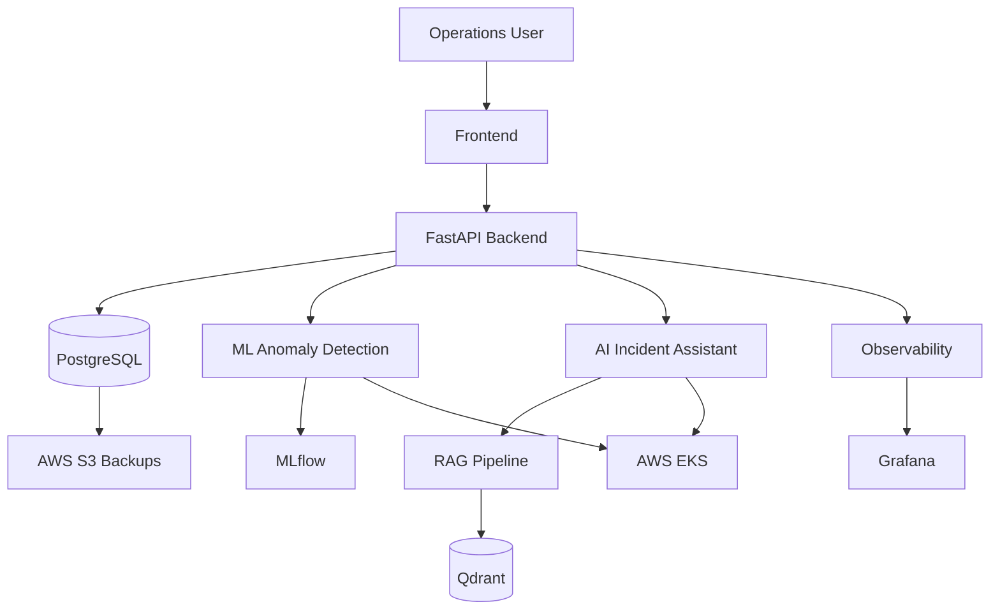

# AI MLOps Platform

An end-to-end production-oriented platform combining DevOps, MLOps, LLMOps, AI Engineering, Cloud Infrastructure, and DevSecOps.

## Project Overview

The platform provides an AI-powered IT Operations Assistant capable of:

- Collecting infrastructure metrics and application logs.
- Detecting infrastructure anomalies using Machine Learning.
- Predicting potential infrastructure incidents.
- Analyzing incidents and recommending troubleshooting steps.
- Answering technical questions using a Retrieval-Augmented Generation (RAG) system.
- Monitoring AI models, applications, and infrastructure.
- Automating ML model training, deployment, and retraining.

## Technology Stack

### Cloud & Infrastructure
- AWS
- Terraform
- Amazon EKS
- Amazon S3
- IAM
- VPC

### Containers & Orchestration
- Docker
- Kubernetes
- Helm

### MLOps
- Python
- Scikit-learn
- MLflow
- Kubeflow
- DVC
- Evidently AI

### AI & LLMOps
- LangChain
- Hugging Face
- Ollama
- RAG
- Qdrant
- LLM Evaluation

### CI/CD & GitOps
- Jenkins
- GitHub Actions
- Argo CD

### Monitoring & Observability
- Prometheus
- Grafana
- Loki
- OpenTelemetry

### Security
- Trivy
- Checkov
- SonarQube
- Kubernetes RBAC

## Architecture



## Repository Structure

- application: Backend APIs and business logic.
- ai: LLM integration, RAG, and AI agents.
- mlops: Machine learning lifecycle and pipelines.
- infrastructure: Terraform and AWS resources.
- kubernetes: Kubernetes configurations.
- deployment: Helm and Argo CD.
- ci-cd: Automated pipelines.
- monitoring: Infrastructure and model observability.
- security: DevSecOps tools and policies.
- tests: Automated testing.

## Local Development

Requirements:

- Python 3.11+
- Docker
- Docker Compose
- Git

Clone the repository:

```bash
git clone https://github.com/YOUR_USERNAME/ai-mlops-platform.git
cd ai-mlops-platform
```

Configure environment variables:

```bash
cp .env.example .env
```

Start the platform:

```bash
docker compose up --build
```


## Development Roadmap

- [x] Initial repository structure
- [x] FastAPI application foundation
- [ ] Incident management API
- [ ] PostgreSQL integration
- [ ] Infrastructure metrics ingestion
- [ ] ML anomaly detection
- [ ] MLflow experiment tracking
- [ ] Model registry and serving
- [ ] RAG-based AI assistant
- [ ] LLM integration and evaluation
- [ ] Kubernetes deployment
- [ ] AWS infrastructure using Terraform
- [ ] CI/CD and GitOps
- [ ] Model drift monitoring
- [ ] Automated model retraining
- [ ] Production security and observability

## Deployment Target

AWS Bahrain Region: me-south-1

## License

MIT License
